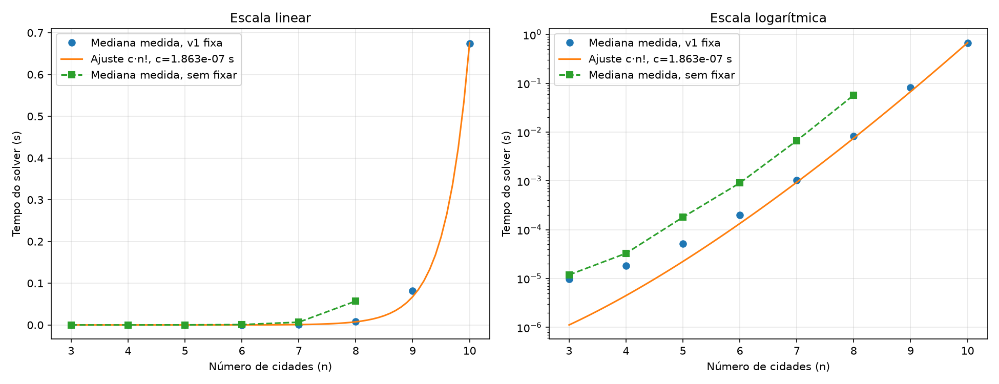

# Projeto do grupo — Análise experimental do TSP por força bruta

> A coleta principal abrange n=3..10. A seção de coletas complementares
> apresenta a evidência de n=12 separadamente, sem combinar amostras ou constantes.

Coleta principal: 02/11/2026, início às 22:41:54 (UTC−03:00).
Identificação acadêmica: [dados do grupo](DADOS_ACADEMICOS.md).

Base didática: Unidade 4, seções 4.1.1 a 4.1.9 e 4.2. A correspondência
entre requisitos, implementação e evidências está em `docs/REVISAO_UNIDADE4.md`.

## Problema, algoritmos e metodologia

Investigamos o ciclo de menor custo que visita cada cidade uma vez e retorna
à origem. Implementamos enumeração integral com origem fixa e comparação sem
fixação. Usamos Held-Karp como método exato complementar e vizinho mais próximo
e 2-opt como heurísticas; eles não substituem a força bruta da atividade.

## Resultados experimentais

O benchmark foi executado com **Python 3.14.3**, sistema
`Windows-10-10.0.19045-SP1` e identificação de processador informada pela plataforma:
`AMD64 Family 25 Model 97 Stepping 2, AuthenticAMD`. Não se infere modelo comercial, RAM ou frequência.
As medições se referem ao ambiente registrado nos metadados. As tabelas
e calibrações desta seção usam exclusivamente a coleta principal identificada.
Não se extrapola a caracterização do hardware além dos dados disponíveis.

Comando executado:

```bash
python tsp_forca_bruta.py --nmin 3 --nmax 10 --repeticoes 3 --sem-fixar --nmax-sem-fixar 8 --saida resultados
```

Concluímos **42 chamadas cronometradas**: 24 fixas e 18 sem fixação.
A matriz de cada n foi idêntica nos dois modos, gerada com semente-base 42
(gerador local com semente 42+n). Usou-se perf_counter apenas no solver,
incluindo validação, permutações, somas, contadores e asserções. Houve uma
chamada de aquecimento não cronometrada por n e modo para n=3,4,5: seis chamadas
extras pequenas. Geração da matriz, escrita e gráfico ficaram fora do intervalo.
A mediana de três repetições é a estatística principal, menos sensível a um
valor extremo que a média; os extremos mostram dispersão e as amostras permitem
auditoria. Isso não remove ruído do sistema nem torna precisas medições curtas.
As contagens da tabela são **por execução**, não a soma das três repetições.

| n | Rotas fixas observadas | Arestas fixas observadas | Mediana fixa (s) | Mín.–máx. (s) | Mediana sem fixar (s) | Razão de rotas observada |
|---:|---:|---:|---:|---:|---:|---:|
| 3 | 2 | 6 | 0.000009799 | 0.000008401–0.000012900 | 0.000011900 | 3 |
| 4 | 6 | 24 | 0.000018500 | 0.000018300–0.000019901 | 0.000032800 | 4 |
| 5 | 24 | 120 | 0.000051100 | 0.000050901–0.000051701 | 0.000180400 | 5 |
| 6 | 120 | 720 | 0.000197800 | 0.000197200–0.000221901 | 0.000907900 | 6 |
| 7 | 720 | 5040 | 0.001040700 | 0.001040000–0.001229400 | 0.006676501 | 7 |
| 8 | 5040 | 40320 | 0.008243300 | 0.008115600–0.008403100 | 0.057149299 | 8 |
| 9 | 40320 | 362880 | 0.082159300 | 0.066845200–0.082255499 | não medido | não medido |
| 10 | 362880 | 3628800 | 0.674535400 | 0.626803600–0.677403300 | não medido | não medido |


Arquivos desta coleta: [execucao_20261102_224154_225839](evidencias/resultados/execucao_20261102_224154_225839/metadados.json),
[resumo](evidencias/resultados/execucao_20261102_224154_225839/resultados_tsp.csv),
[repetições](evidencias/resultados/execucao_20261102_224154_225839/repeticoes.csv) e
[projeções](evidencias/resultados/execucao_20261102_224154_225839/projecoes.csv).



Os pontos representam medianas reais. A linha usa c·Γ(n+1), equivalente a c·n!
nos inteiros, restrita ao intervalo medido. O ajuste por mínimos quadrados sem
intercepto é `c = Σ(n!·t_mediana) / Σ((n!)²)`, com todos os pontos fixos,
resultando em **c = 1.86287374502998e-07 s**. Os maiores n dominam esse ajuste.
O CSV usa o mesmo c, sem arredondamento intermediário. A tabela de projeções
até n=20 contém estimativas: dentro da amostra, ajuste; fora dela, extrapolação.
Nenhum desses valores estimados é contado como nova execução. O ajuste na
própria amostra não prova complexidade.

## 1. Redução do espaço de busca

Sem fixação, existem n! sequências. Um mesmo ciclo dirigido aparece n vezes,
uma para cada escolha da cidade inicial (rotações). Fixar v1 elimina essa
redundância e deixa (n−1)! sequências. Portanto n!/(n−1)! = n, exatamente.
As colunas observadas confirmam a razão n em todos os tamanhos comparados.
Por exemplo, n=8 gerou 5.040 rotas fixas e 40.320 sem fixação.

Em grafos simétricos, inverter uma rota conserva seu custo. Ambas as orientações
permanecem deliberadamente na enumeração para seguir o enunciado. Não houve
eliminação adicional de simetrias, poda, branch-and-bound, memoização ou cálculo
incremental do custo. O backtracking apenas enumera todas as permutações e
entrega uma tupla independente em cada folha.

A razão dos tempos não é obrigada a ser n: alocações, ruído, aquecimento e
composição das operações afetam o tempo. A economia exata se refere às rotas.

## 2. Avaliação linear

Para cada rota, o laço percorre i=0,...,n−1 e soma
`d[rota[i]][rota[(i+1) % n]]`. O último termo fecha o ciclo na origem.
Cada execução do corpo incrementa uma unidade no contador de arestas.
Avaliar uma rota custa Θ(n), inclusive se vários custos forem zero.

Com início fixo, são n·(n−1)! = n! somas, e o tempo desta implementação é
Θ(n!). Sem fixar, são n·n! somas e tempo Θ(n·n!). Os custos da enumeração e
cópia das permutações não reduzem essas ordens. A contagem de arestas não é
a contagem de todas as operações primitivas do programa; ela mede precisamente
os acessos/somas de arestas do laço. Asserções confrontam os contadores com as
fórmulas ao final e os testes verificam esses resultados nos dois modos.

## 3. Limiar prático e crescimento

Na coleta principal, o maior tamanho medido com início fixo foi **n=10**, com mediana
**0.674535400 s**, mínimo 0.626803600 s e máximo
0.677403300 s. Sem fixar, o maior tamanho foi **n=8**,
com mediana **0.057149299 s**. Nenhuma repetição atingiu minutos:
**o limiar prático de minutos não foi observado**. Não executamos n=11,12,13
ou maiores nesta coleta. A seção de coletas complementares apresenta
os resultados posteriores sem agregá-los à amostra principal.

O modelo fatorial cresce por fator n+1 entre tamanhos consecutivos. Isso
explica o rápido aumento da tabela combinatória. Merge Sort tem tempo
Θ(n log n): seu fator de crescimento entre tamanhos consecutivos é muito
menor para n grande. Esta é uma comparação assintótica, sem medições de
Merge Sort neste trabalho. A dificuldade desta enumeração não prova que
qualquer algoritmo para o TSP precise enumerar todas as rotas. Held-Karp é
um exemplo de método exato com complexidade exponencial menor que fatorial:
O(n²·2ⁿ) em tempo e O(n·2ⁿ) em memória.

## 4. P versus NP e heurísticas

P e NP são classes de **problemas de decisão**. P contém os decidíveis por
algoritmo determinístico em tempo polinomial no tamanho da entrada. NP contém
os que admitem certificados de tamanho polinomial verificáveis em tempo
polinomial. P está contida em NP; NP não significa “não polinomial”. A igualdade
P=NP continua em aberto, conforme o [Clay Mathematics Institute](https://www.claymath.org/millennium/p-vs-np/).

Na formulação padrão com custos inteiros codificados na entrada, o TSP de
decisão pergunta se há ciclo de custo <= B e é NP-completo. O TSP de otimização,
que pede o ciclo de menor custo, é NP-difícil; uma solução polinomial para a
otimização resolveria a decisão. Verificar um ciclo e somar seus custos é
polinomial. O experimento usa distâncias euclidianas em ponto flutuante e não
constitui prova de uma classificação de complexidade. A explosão observada
não prova P≠NP, e não implica que todo método exato deva ser fatorial.

O vizinho mais próximo é uma heurística gulosa, O(n²) nesta implementação,
sem garantia geral de ótimo. No contraexemplo reproduzido com cidades
(4,0), (4,2), (0,2), (2,4), (5,2), o guloso partindo de 0 produz **[0, 1, 4, 3, 2]**,
custo **13.906114355** (incluindo retorno). A força bruta encontra
custo **13.365058182**. A execução separada da combinação com 2-opt produziu
rota **[0, 4, 1, 3, 2]**, custo **13.365058182**. Assim, a falha demonstrada é a do
guloso; não se atribui automaticamente essa falha à combinação.

O 2-opt é busca local: troca duas arestas e inverte um segmento quando melhora.
Em matriz simétrica, o delta das extremidades é calculado em O(1); em matriz
assimétrica seria necessário considerar também as arestas internas invertidas,
por isso a API desta versão rejeita assimetria para o 2-opt. Há O(n²) pares
examinados por passada, e cada inversão em Python custa até O(n), dando limite
O(n³) por passada. Executar até convergir não oferece garantia polinomial do
número de passadas. O trabalho de [Englert, Röglin e Vöcking](https://arxiv.org/abs/2302.06889)
apresenta famílias com caminhos de melhorias exponenciais, inclusive em
instâncias euclidianas; não se generaliza um bom desempenho empírico a uma
garantia de pior caso. O ótimo local também não garante ótimo global.

Uma heurística é um procedimento de busca de boas soluções que pode não ter
garantia de ótimo. Metaheurísticas são estratégias mais gerais para orientar
a busca: simulated annealing pode aceitar pioras com probabilidade controlada
pela temperatura; busca tabu usa memória para restringir movimentos e evitar
ciclos; algoritmos genéticos mantêm populações, seleção e variação. O 2-opt
simples não é automaticamente classificado como metaheurística.

## Validação e limitações

Os testes automatizados verificam ótimos conhecidos, comparação com oráculo
independente de itertools, Held-Karp, integridade da rota, matriz preservada,
contagens exatas, entradas inválidas, exportações e calibração. A validação da
interface abrange processos, cancelamento, recuperação e exclusão em diretórios
temporários. Não se usa tempo de execução como critério de aprovação.
Os procedimentos e resultados estão em `docs/VALIDACAO.md`.

Três repetições, uma instância por n e um ambiente limitam a análise principal.
Não foi medido consumo de memória nem foi realizado benchmark de Merge Sort.
O ajuste na própria amostra não estabelece uma prova de complexidade.

## Coletas complementares e aplicação local

A análise principal usa `evidencias/resultados/execucao_20261102_224154_225839/`, com
três repetições e máximo fixo n=10. Os conjuntos seguintes são experimentos
distintos. A observação de minutos pertence à coleta complementar e não altera
retroativamente as estatísticas da amostra principal. Os valores foram lidos
dos registros preservados, sem nova execução desses tamanhos nesta validação.

- `evidencias/resultados/execucao_20261102_224647_285820/`: segunda coleta da mesma faixa,
  três repetições, com sua própria constante c.
- `evidencias/meus_resultados/execucao_20261102_224749_115690/`: n=10 e 11, uma repetição;
  n=11 registrou 6,514094199985266 s.
- `evidencias/meus_resultados/execucao_20261102_224818_019551/`: solicitou n=10..16,
  uma repetição, mas está marcada como interrompida. Tem somente 10,11,12
  concluídos. Não se infere em qual tamanho posterior ocorreu a interrupção.

| n | Tempo registrado (s), uma repetição | Rotas observadas | Arestas observadas |
|---:|---:|---:|---:|
| 10 | 0,6075698994100094 | 362880 | 3628800 |
| 11 | 6,578626500442624 | 3628800 | 39916800 |
| 12 | 76,40297299996018 | 39916800 | 479001600 |

Fonte direta: [resumo da coleta interrompida](evidencias/meus_resultados/execucao_20261102_224818_019551/resultados_tsp.csv)
e [metadados](evidencias/meus_resultados/execucao_20261102_224818_019551/metadados.json).
**Foi observado um caso acima de um minuto em n=12 naquele ambiente.** Uma
repetição não determina limiar universal nem caracteriza dispersão. Não há
medição completa de n=13..16 nesses arquivos. c desta coleta é
1,595416578180285e-07 s, ajustado somente a 10,11,12; não foi combinado com c
ou medianas da primeira coleta. Projeções continuam estimativas, não execuções.

A aplicação web lê as coletas de terminal por adaptador estruturado. Quando
reconstitui coordenadas pela semente, confere a matriz salva e identifica a
reconstrução. Tarefas web registram sua origem, configuração, coordenadas,
matriz, protocolo de medição e resultados por chamada. A duração da interface
não é tempo científico. Apenas a função do solver é cronometrada no filho;
progresso, comunicação e exportação ficam fora do intervalo.

A seleção dos conjuntos distribuídos e sua finalidade estão em
`RESULTADOS_SELECIONADOS.md`. Cada coleta conserva sua própria constante e
suas amostras. Nenhuma projeção é apresentada como uma execução observada.

## Conclusão

As contagens confirmam a economia de fator n ao fixar a origem e o custo
linear de avaliar cada ciclo. O crescimento fatorial limita o alcance prático:
observamos mais de um minuto em n=12 na coleta complementar, sem inferir um
limiar universal. Os métodos heurísticos ampliam a escala de busca, mas não
garantem o ótimo. Os resultados empíricos sustentam a análise desta implementação
e não resolvem a questão P versus NP.

## Referências

- Universidade de Vila Velha. **Projeto e Análise de Algoritmos, Unidade 4**.
  Material didático fornecido para a atividade, seções 4.1 e 4.2, 11 páginas.
- Clay Mathematics Institute. **P vs NP**.
  https://www.claymath.org/millennium/p-vs-np/
- Englert, Matthias; Röglin, Heiko; Vöcking, Berthold. **Worst Case and
  Probabilistic Analysis of the 2-Opt Algorithm for the TSP**. arXiv:2302.06889.
  https://arxiv.org/abs/2302.06889
